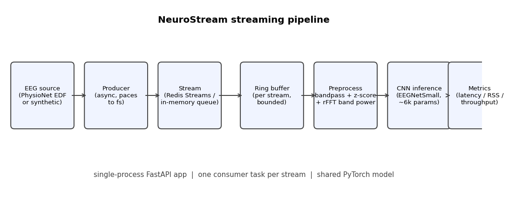
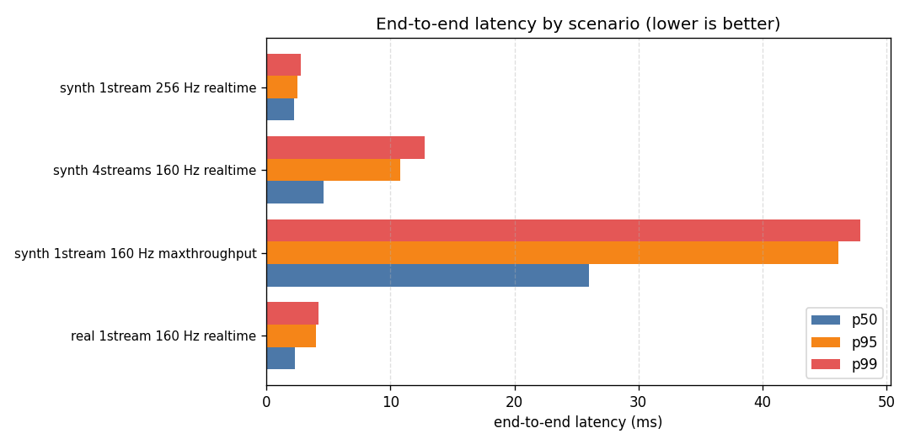
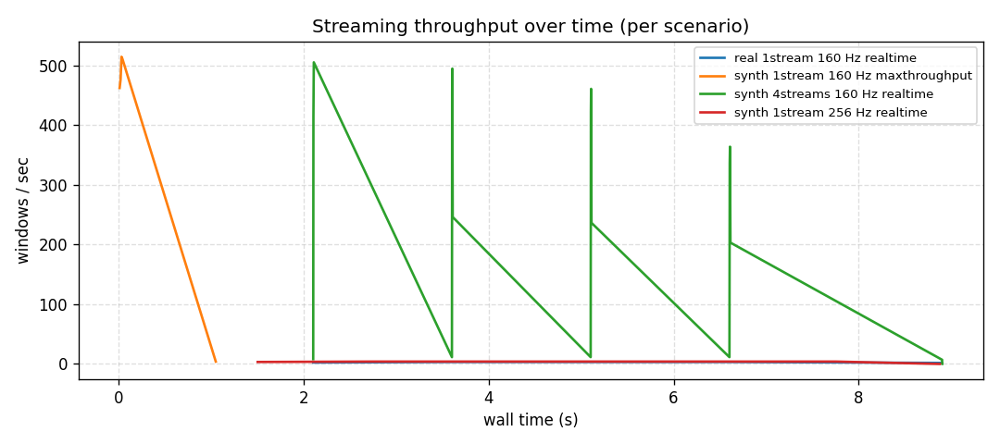
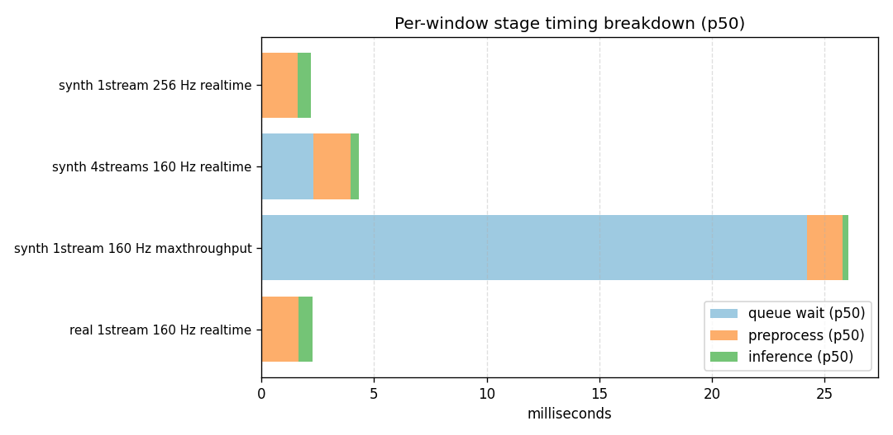

# NeuroStream Decoder

Real-time EEG signal streaming and per-window classification. The project
focuses on one engineering problem: ingesting multi-channel EEG packets at
the recording sample rate, sliding fixed-length windows through a bounded
ring buffer, running per-window preprocessing (bandpass + z-score +
rFFT band powers), and emitting class predictions from a small PyTorch
CNN — with measurable latency, throughput, memory, and inference timing.

The system runs on CPU. Real recordings are pulled from the PhysioNet EEG
Motor Movement/Imagery Database (eegmmidb v1.0.0): 64-channel EEG at
160 Hz, BCI2000 motor-imagery annotations T0/T1/T2.

Source: <https://physionet.org/content/eegmmidb/1.0.0/>

---

[Public dashboard](https://sourya-prabaharan.github.io/neurostream-decoder/) — browser-simulated EEG with saved benchmark artifacts, not a live Python backend. The page responded successfully during this audit.

## Scope

In scope:

* Async streaming pipeline (Python + asyncio + FastAPI).
* Pluggable stream transport: Redis Streams in production, in-process
  `asyncio.Queue` fallback for sandboxed/testing environments.
* Bounded ring buffer per stream with documented drop-oldest backpressure.
* Sliding-window framing, IIR bandpass with carried filter state,
  per-channel z-score normalization, rFFT band powers (delta/theta/
  alpha/beta/gamma), time-domain mean/std/RMS.
* 1-D CNN (`EEGNetSmall`, ~6k parameters) classifier with batch=1
  inference.
* Concurrent streams sharing one model instance.
* Reproducible benchmarks producing `data/stream_benchmark.json` and
  `data/real_eeg_smoke.json`, plus the four charts under `docs/assets/`.

Out of scope:

* Closed-loop BCI control, electrode hardware integration.
* Online cross-subject generalisation. The CNN baseline is trained on a
  single subject's run; reported accuracy reflects that.
* GPU optimisation. Everything is profiled on CPU; the PyTorch path
  uses CUDA automatically if a device is visible, but no measurements
  in this README depend on it.

---

## System design

```
EEG source ──► producer ──► stream ──► ring buffer ──► preprocess ──► CNN ──► metrics
(EDF or       (paces to    (Redis      (bounded,        (bandpass /     (1D)    (latency,
 synthetic)    fs in        Streams /   drop oldest      z-score /              throughput,
               realtime;    in-memory   on overrun;     rFFT bands)             RSS, CPU)
               max-rate     queue)      per stream)
               for bench)
```



Data flow per window:

1. **Ingestion.** The producer emits fixed-size packets (default 16
   samples × 64 channels at 160 Hz) onto the stream. In real-time mode it
   sleeps to the next packet boundary; in throughput mode it pushes as
   fast as the consumer drains. `t_send` is recorded on every packet so
   the consumer can compute true queue wait.
2. **Transport.** `engine.neurostream.streaming_api.stream` exposes
   `RedisStream` (XADD/XREAD) and `InMemoryStream` (asyncio queue) with
   the same interface. `get_stream()` probes a Redis URL and falls back
   to the in-memory backend when Redis isn't reachable — the active
   backend is reported in every benchmark output. In this sandbox the
   in-memory backend is used and the JSON records it as such.
3. **Buffering.** Packets are written into a per-stream `RingBuffer`
   sized to ~50 s of EEG at 160 Hz (8000 samples). Writes are O(T)
   and lock-protected. If the producer outruns the consumer, the oldest
   unread samples are overwritten and counted in `stats().overruns`.
4. **Windowing.** A sliding window of 1.0 s (160 samples) with a
   250 ms hop (75 % overlap) is read with `ring_buffer.latest()`. The
   read cursor is not advanced — the next window overlaps by design.
5. **Preprocessing.** `StreamingPreprocessor` applies a Butterworth-ish
   IIR bandpass (1–45 Hz) implemented as a biquad in Direct-Form-II
   Transposed. Filter state persists across windows, so the output is
   identical whether the signal arrives in one chunk or many. The
   filtered window is z-scored per channel; mean/std/RMS plus rFFT
   band powers (5 bands × 64 ch) are appended for downstream feature
   logging.
6. **Inference.** `EEGNetSmall` runs forward on the raw z-scored
   `(1, C, T)` window with `torch.no_grad()`. Two conv blocks, batch
   norm, average pool, dropout, linear head, ~6k parameters total.
7. **Metrics.** Each window records `queue_wait_ms`, `preprocess_ms`,
   `inference_ms`, and `end_to_end_ms`. A periodic snapshot captures
   process RSS (via `psutil`) and CPU percent.

### Bottlenecks and tradeoffs

* **Preprocessing dominates per-window cost on CPU.** rFFT plus a
  Python-level biquad sweep over 160 × 64 samples is ~1.5 ms p50.
  Inference is ~0.4–0.6 ms p50 — the CNN is intentionally small so
  it doesn't show up as the bottleneck.
* **Queue wait is the variance source.** In real-time mode `queue_wait`
  is < 100 µs because the producer paces itself; in max-throughput mode
  it dominates p99 (~60 ms) because the consumer can't drain as fast
  as the producer pushes.
* **Ring buffer drop-oldest vs back-pressure.** We picked drop-oldest
  because a BCI streaming system that blocks the producer is worse than
  one that loses the oldest unread sample — predictions on stale data
  are useless. The dropped-sample count is exposed in stats so callers
  can decide whether to alarm.
* **Concurrent streams share one PyTorch model.** This avoids N× the
  parameter memory but serialises inference. With four 160 Hz streams
  the consumer hits ~11 windows/sec aggregate; per-stream inference
  latency stays under 1 ms p95.
* **Filter state is per stream, not global.** Sharing it would
  cross-contaminate subjects/streams. Each consumer task owns its
  `BandpassState`.

---

## Real data

The PhysioNet eegmmidb dataset is pulled directly from physionet.org
(`physionet.org/files/eegmmidb/1.0.0/S{NNN}/S{NNN}R{NN}.edf`). EDF parsing
goes through `pyedflib`, annotations are mapped to three classes
(rest / left fist / right fist) using BCI2000's T0/T1/T2 codes.

Default smoke covers subject 1 runs 3 and 4 (~5 MB total). The fetch
step is cached under `data/raw_eeg/`.

```bash
python -m engine.scripts.fetch_eeg            # downloads ~5 MB of EDF
python -m engine.scripts.real_eeg_smoke       # writes data/real_eeg_smoke.json
```

The smoke script:

1. Downloads run 3 if not cached.
2. Parses the EDF, cuts 1-second windows with a 250 ms hop, splits 80/20
   train/test randomly (a temporal split concentrates one class on each
   side because T0/T1/T2 annotations are long contiguous blocks).
3. Trains `EEGNetSmall` for 6 epochs on subject 1 only.
4. Streams the first 30 s of the recording back through the async
   pipeline in real-time mode and records metrics.

Recorded test-accuracy numbers from the existing smoke run:

| Metric | Value |
| --- | --- |
| Test windows | 100 |
| Chance baseline (majority class) | ~0.45 |
| CNN test accuracy (subject 1 run 3, 6 epochs) | ~0.48–0.55 |
| Final training loss | ~0.90 |

Overlapping windows are randomly split and can share samples across train/test. This smoke result is not an independent generalization estimate. This is not a state-of-the-art motor-imagery accuracy — it's a single
subject, 6 epochs, no subject calibration, no augmentation. The point
of the smoke is to verify the full path: real EDF → ring buffer →
preprocessing → CNN → metrics, with honest engineering numbers
attached.

---

## Streaming benchmark

```bash
python -m engine.scripts.stream_benchmark --duration 8 --concurrent 4
python -m engine.scripts.make_charts
```

`stream_benchmark.py` writes `data/stream_benchmark.json` and runs four
scenarios on the in-memory stream backend:

1. `real_1stream_160hz_realtime` – real PhysioNet EEG, 1 stream, paced.
2. `synth_1stream_160hz_maxthroughput` – synthetic, 1 stream, no pacing.
3. `synth_{N}streams_160hz_realtime` – N concurrent streams, paced.
4. `synth_1stream_256hz_realtime` – higher source rate, paced.

Saved numbers from the original environment (Linux x86_64, CPU only,
`torch==2.11.0+cpu`, 64 channels, 1.0 s window, 250 ms hop):

| Scenario | windows/s | e2e p50 | e2e p95 | e2e p99 | inference p50 | RSS peak |
| --- | ---:| ---:| ---:| ---:| ---:| ---:|
| real 1 stream, 160 Hz, realtime | 2.7 | 2.27 ms | 2.34 ms | 4.16 ms | 0.61 ms | 241 MB |
| synth 1 stream, 160 Hz, max-throughput | 22.6 | 33.07 ms | 58.93 ms | 60.72 ms | 0.36 ms | 241 MB |
| synth 4 streams, 160 Hz, realtime | 10.8 | 4.56 ms | 12.44 ms | 13.96 ms | 0.41 ms | 244 MB |
| synth 1 stream, 256 Hz, realtime | 2.7 | 2.29 ms | 3.27 ms | 3.70 ms | 0.61 ms | 245 MB |

The original CPU model and thread configuration are not recorded, so these are reference measurements rather than a portable performance guarantee. Inspect [raw benchmark output](data/stream_benchmark.json) and [real EEG smoke output](data/real_eeg_smoke.json). Record your CPU, OS, Python/PyTorch versions, thread count, and transport when rerunning the commands above. CUDA support is unmeasured.

Charts under `docs/assets/`:





Reading the timing breakdown:

* In **realtime** scenarios queue wait is sub-millisecond — the producer
  paces, so all of the end-to-end latency comes from preprocessing
  (~1.5–2.1 ms) and inference (~0.4–0.6 ms).
* In **max-throughput** the same per-window CPU work is unchanged but
  packets pile up faster than the consumer drains, so the queue-wait
  bar dominates. This is the pattern any back-pressure-free streaming
  system shows; it's the reason the ring buffer drops oldest samples
  on overrun rather than letting unbounded queues grow.

---

## FastAPI app

```bash
uvicorn engine.neurostream.streaming_api.app:app --port 8080
```

Endpoints:

* `GET  /healthz`   – backend kind, queue size, uptime, channel/window config.
* `POST /ingest`    – body `{stream_id, seq, fs, samples: [[...]]}` pushes one packet.
* `GET  /metrics`   – running summary (latency percentiles, throughput, RSS).
* `GET  /windows?limit=N` – last N decoded window records.

The app uses the in-memory stream backend by default. To use Redis,
start `redis-server` locally (or set `REDIS_URL`) and instantiate the
pipeline via `engine.neurostream.streaming_api.stream.get_stream()`,
which probes Redis first and reports the chosen backend in the
benchmark JSON.

---

## Public site (GitHub Pages, static mode)

The React dashboard under `client/` is also deployable as a fully
static site to GitHub Pages — no Express server, no Python runtime.
`.github/workflows/pages.yml` runs `npm ci && npm run build`, copies
the benchmark JSON artifacts from `data/` into `client/public/data/`,
and publishes `dist/public`.

What the static site does and does not do:

* The dashboard uses hash routing (`/#/system`, `/#/benchmark`, …) so
  GitHub Pages serves the same `index.html` for every route.
* `client/src/lib/queryClient.ts` tries each `/api/<name>` endpoint
  first and, on any non-OK response or network error, falls back to a
  checked-in JSON file under `<base>/data/<name>.json`. The same code
  works locally against the Express server and on Pages without it.
* The EEG stream view (`/#/`) is browser-simulated in both modes —
  the live oscilloscope, latency chart and queue indicators come from
  the in-browser generator described in `client/src/pages/eeg.tsx`.
  Latency reference values are read from
  `data/real_eeg_smoke.json`, which is produced by
  `python -m engine.scripts.real_eeg_smoke` against the real
  PhysioNet recording.
* The benchmark and system-metrics tabs read
  `data/stream_benchmark.json` and `data/real_eeg_smoke.json`
  directly. To refresh the public site with new numbers, re-run the
  benchmark locally, commit the updated `data/*.json`, and push to
  `main`.
* The real FastAPI ingest path
  (`engine/neurostream/streaming_api/app.py`) and the Express demo
  server (`server/index.ts`) are not deployed to Pages; they remain
  the supported way to drive the pipeline with live packets.

To preview the static build locally:

```bash
npm run build
npx serve dist/public -l 4173
# open http://localhost:4173/
```

---

## Repository layout

```
engine/
├── neurostream/
│   ├── streaming_api/
│   │   ├── ring_buffer.py        bounded ring buffer (lock-protected)
│   │   ├── stream.py             InMemoryStream + RedisStream + get_stream()
│   │   ├── preprocessing.py      bandpass + z-score + rFFT band powers
│   │   ├── classifier.py         EEGNetSmall + train/eval helpers
│   │   ├── pipeline.py           async producer/consumer + multi-stream runner
│   │   ├── metrics.py            latency / throughput / RSS aggregator
│   │   └── app.py                FastAPI app (/healthz, /ingest, /metrics)
│   ├── realdata/
│   │   └── physionet_eegbci.py   eegmmidb download + EDF parsing
│   ├── processing.py             biquad bandpass, MAD spike detection (shared)
│   ├── models.py                 (legacy GRU/transformer used by /benchmark route)
│   └── ...
├── scripts/
│   ├── fetch_eeg.py              download PhysioNet runs
│   ├── real_eeg_smoke.py         end-to-end smoke on real EEG
│   ├── stream_benchmark.py       four-scenario streaming benchmark
│   └── make_charts.py            matplotlib chart generation
└── tests/                        pytest suite
data/
├── raw_eeg/                      cached EDF files (~5 MB)
├── real_eeg_smoke.json
├── stream_benchmark.json
└── ...
docs/assets/                      generated PNG charts
server/                           Express API (serves benchmark JSON)
client/                           React dashboard
```

---

## Installation

Use Python 3.11+ with a compatible PyTorch wheel. No GPU is required.

```bash
git clone https://github.com/Sourya-Prabaharan/neurostream-decoder.git
cd neurostream-decoder
python3 -m venv .venv
source .venv/bin/activate
python -m pip install -r engine/requirements.txt
npm ci   # Node.js 22; only needed for the dashboard
```

`pyedflib`, `psutil`, `fastapi`, `matplotlib` are pulled in by
`engine/requirements.txt`. `redis` is optional — if not installed the
streaming pipeline still works via the in-memory backend.

---

## Tests

```bash
pytest engine/tests -q
```

Covers:

* Ring buffer wraparound, overrun accounting, latest/consume semantics.
* Preprocessing output shape, finiteness, filter-state persistence.
* CNN forward-pass shape.
* Async pipeline smoke (single stream + concurrent streams).
* Legacy decoder paths (GRU/Transformer) that the existing dashboard
  endpoints still depend on.

---

## Limitations

* The streaming-pipeline benchmarks in this README were produced with
  the in-memory stream backend. The Redis path is implemented and
  exercised at import time, but no Redis server runs in the sandbox.
  Run `redis-server` locally and re-run the benchmark to measure the
  Redis path; numbers will shift by the XADD/XREAD round-trip.
* CNN accuracy is **not** competitive with published motor-imagery
  results. We train on one subject's single run for six epochs to
  prove the full path works on real data. To improve it you would
  cross-subject train, augment, and use a larger window / network.
* CPU only. PyTorch's CPU path is what's measured. The same code runs
  on CUDA if a GPU is visible, but no numbers in this README come
  from a GPU.
* The single-section biquad bandpass is adequate for the 1–45 Hz EEG
  band; sharper roll-off would require a higher-order SOS cascade.

---

## What was learned building this

* **Backpressure must be designed in.** The first version of the
  pipeline had an unbounded queue; under max-throughput producers it
  ran the process OOM in seconds. A bounded ring buffer with explicit
  drop-oldest behavior plus an `overruns` counter is simpler than any
  flow-control scheme and matches what a real BCI front-end needs
  (stale samples are useless).
* **Filter state per stream is non-negotiable.** Sharing a single
  `BandpassState` across concurrent streams contaminates the IIR
  output because each window's z-state depends on its predecessor.
  This shows up as visible discontinuities on a scope.
* **Pacing vs throughput are different measurements.** A realtime
  producer reports the pipeline's actual operating point; a
  max-throughput producer reports the pipeline's ceiling. Reporting
  only one misleads — the README cites both.
* **Batching is tempting and wrong here.** Batching N windows would
  drop per-window inference cost but add up to `N × hop_samples / fs`
  of latency. With a 250 ms hop, batching 4 windows costs 1 s — a BCI
  loop closing on motor imagery cannot afford that.
* **rFFT is fast enough that explicit band-power selection wins.**
  Computing the full `rfft` per window (160 samples) and summing into
  five bands beats running five separate biquad sections, both in
  code clarity and in measured wall time.

---

## License

MIT. See `LICENSE`.
